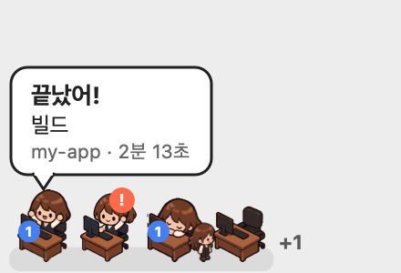

# BG Buddy

Claude Code 세션들이 지금 무엇을 하는지 화면 구석에 보여주는 macOS 플로팅 HUD.
백그라운드 작업이 돌면 움직이고, 끝나 결과가 돌아오면 말풍선으로 알려줍니다.

두 가지 모드가 있습니다.

- **캐릭터 하나** (`buddy`, 기본) — 캐릭터 하나가 백그라운드 작업 전체를 대표합니다
- **사무실** (`office`) — 세션마다 책상 하나. 누가 일하고, 누가 쉬고, 누가 내 답을 기다리는지 한눈에 보입니다



*사무실 모드 (가짜 세션으로 그린 예시). 작업이 끝나 만세하는 my-app · 질문에 답을 기다리는 api-server ·
에이전트를 옆에 두고 조는 docs · 퇴근해 빈 책상만 남은 data-pipeline · 자리가 없어 `+1` 로 표시된 세션*

캐릭터 하나 모드:

```
        ╭──────────────────────╮
        │ 끝났어!               │
        │ Audit data services  │
        │ my-app · 2분 13초     │
        ╰─────────┬────────────╯
               (•ᴗ•)  ③        ← 도는 작업이 여럿이면 개수 배지
```

- 작업 중 — 캐릭터가 움직입니다
- 끝남 — 기뻐하는 동작과 말풍선 (실패하면 빨간 말풍선, 직접 끈 작업은 회색 "멈췄어")
- 쉬는 중 — 잠든 모습 (숨기도록 설정할 수도 있음)

터미널 `claude`, 데스크톱 앱의 Code 탭, VS Code 확장, 백그라운드 세션(`claude --bg`) 어디서 실행했든
**이 맥에서 도는 Claude Code 세션이면 모두** 잡힙니다.

## 사무실 모드

`buddy mode office` 로 바꾸면 캐릭터 하나 대신 **세션마다 책상 하나**가 놓인 작은 사무실이 됩니다
(최대 4개, 넘치면 `+N`). 돌아가려면 `buddy mode buddy`, 또는 메뉴의 **사무실 모드**.

| 세션 상태 | 화면 | 근거 |
|---|---|---|
| 작업 중 | 키보드를 침 | `~/.claude/sessions/<pid>.json` 의 `status: busy` |
| 쉬는 중 | 책상에 엎드려 졺 | `status: idle` |
| 오래 쉼 (기본 30분) | **퇴근** — 사람이 걸어 나가고 빈 책상만 남음. 다시 일하면 걸어 들어와 앉음 | `statusUpdatedAt` 으로 잰 쉰 시간 |
| 질문에 답을 기다림 | 손을 들고 `!` 배지 | 트랜스크립트에 답이 안 온 `AskUserQuestion` |
| 백그라운드 작업 | 책상에 파란 숫자 배지, 끝나면 만세 + 말풍선 | 위 "동작 방식" 과 같음 |
| 백그라운드 에이전트 | 책상 옆에 선 사람 | 백그라운드로 띄운 `Agent` |
| 세션 시작·종료 | 걸어 들어와 앉음 / 걸어 나가고 책상도 치움 | 세션 목록에 생김·빠짐 |

- 사람마다 머리 모양이 다릅니다. 세션 ID 로 정해져 껐다 켜도 같고, 화면에 앉은 사람끼리는 겹치지 않습니다
- 4명이 넘으면 질문 대기 > 작업 중 > 쉬는 중 > 퇴근 순으로 앉히고, 앉은 사람은 출근 순서대로 둡니다
- Claude 데스크톱 앱은 대화를 안 봐도 세션 프로세스를 살려 둡니다. 그래서 "프로세스가 끝나면 퇴근"이 아니라
  **오래 쉬면 퇴근**으로 정했습니다. 질문에 답을 기다리거나 백그라운드 작업이 도는 세션은 자리를 지킵니다
- 책상에 마우스를 올리면 세션 이름과 상태, 클릭하면 말풍선으로 보여줍니다
- 권한 승인 대기는 아직 구분하지 않습니다 (트랜스크립트에 남지 않아 추정이 필요함)
- 크기는 앉은 사람과 책상을 합친 높이 40pt 가 기본이고, 메뉴의 **크기**(`size`)로 함께 커지고 작아집니다
- 그림은 `characters/office/` 의 머리 모양별 시트 4장입니다 (사람과 책상이 한 프레임에 그려진 45도 그림).
  바꾸는 법은 아래 "사무실 그림 바꾸기"

## 설치

**필요한 것은 Xcode Command Line Tools 하나뿐입니다.** 없으면 먼저 설치하세요:

```bash
xcode-select --install
```

```bash
git clone <저장소 주소> bg-buddy
cd bg-buddy
./install.sh
```

스크립트가 하는 일:

1. `~/Applications/BgBuddy/` 에 소스와 캐릭터 복사
2. `swiftc` 로 그 자리에서 빌드 — 남이 서명한 바이너리를 받는 게 아니라
   내 맥에서 컴파일하므로 Gatekeeper 차단이 없습니다
3. `~/.local/bin/buddy` CLI 설치
4. 로그인 시 자동 실행 등록 (LaunchAgent)
5. 실행 — 캐릭터가 화면 **오른쪽 아래**에 뜹니다

Claude Code 설정은 건드리지 않습니다. 훅도 등록하지 않습니다.

동작 확인:

```bash
buddy doctor     # 세션·트랜스크립트·캐릭터 점검
buddy test       # 말풍선 시험
```

업데이트는 `git pull && ./install.sh`, 제거는 `./uninstall.sh` 입니다.
직접 넣은 캐릭터는 제거 전에 홈 폴더로 백업합니다.

## 조작

- **드래그** 이동 (위치 저장됨)
- **클릭** — 말풍선이 떠 있으면 닫기, 아니면 지금 도는 작업 보기
- **마우스 올리기** — 도는 작업 목록 툴팁
- **우클릭** — 캐릭터 보이기 · 사무실 모드 · 작업 목록 · 캐릭터 · 크기 · 쉴 때 숨기기 · 메뉴 막대 아이콘 · 로그 보기 · 말풍선 테스트 · 종료

### 사건 기록

세션들이 언제 출근하고 퇴근했는지, 누가 누구에게 메시지를 보냈는지 하루 단위로 쌓입니다.
메뉴의 **로그 보기…** 로 창에서 보거나(날짜·세션별로 걸러 보기), `buddy log` 로 터미널에서 봅니다.

```
14:02:11  출근     my-app-pm
14:03:40  출근     my-app-dev (백그라운드)
14:03:52  메시지   my-app-pm → my-app-dev  “[pm-dev-pipeline] 문구 수정 구현 요청 (왕복 1/3)”
14:11:05  작업 끝  my-app-dev xcodebuild test · 4분 12초
14:12:02  질문     my-app-pm · 판정
14:46:10  퇴근     my-app-dev (31분 쉼)
```

| 사건 | 근거 |
|---|---|
| 출근·종료 | 세션 목록에 생김·빠짐 (`claude --bg` 백그라운드 세션은 "(백그라운드)") |
| 퇴근·복귀 | 사무실 모드와 같은 기준 (`leave_after_minutes` 넘게 쉼) |
| 질문·답 받음 | `AskUserQuestion` 과 그 답. 질문 내용 대신 짧은 꼬리표(header)만 |
| 작업 시작·끝 | 백그라운드 작업 (성공·실패·멈춤과 걸린 시간) |
| 메시지 | 세션 간 메시지. **본문은 첫 줄만** 남깁니다 |

- 위치: `~/Library/Logs/BgBuddy/YYYY-MM-DD.jsonl` — 한 줄에 사건 하나(JSON). 다시 설치해도 남고, 30일 지난 파일은 지웁니다.
  제거 스크립트도 이 폴더는 지우지 않습니다
- BG Buddy 가 켜져 있는 동안 생긴 사건만 쌓입니다. 켤 때는 과거를 다시 채우지 않고 "시작" 한 줄만 남깁니다
- 매 턴의 "일 시작·쉬기" 는 대화할 때마다 생겨 기록을 뒤덮으므로 남기지 않습니다
- 같은 메시지가 몇 초 안에 반복 기록되면 한 번으로 셉니다 (받는 쪽 기록에 두 번 남는 경우가 있음)

### 메뉴 막대 아이콘

화면 맨 위 메뉴 막대 오른쪽에 캐릭터 아이콘이 생깁니다. 클릭하면 우클릭 메뉴와 같은 메뉴가 열립니다.

- 작업이 돌면 아이콘 옆에 개수(`2`), 방금 끝났으면 잠깐 `✓`
- **캐릭터 보이기**를 끄면 캐릭터와 말풍선이 모두 사라지고, 끝난 작업은 메뉴 막대의 `✓` 로만 알립니다.
  다시 켰을 때 지난 알림이 몰려 뜨지 않습니다
- **쉴 때 숨기기**는 작업이 없을 때만 숨고, 작업이 돌거나 끝나면 나타납니다
- 캐릭터와 메뉴 막대 아이콘을 둘 다 끌 수는 없습니다 — 다시 켤 곳이 없어지므로 하나를 끄면 다른 하나가 켜집니다

캐릭터와 말풍선이 아닌 투명한 부분은 클릭이 아래 창으로 그대로 통과합니다.

## 명령

```
buddy                    캐릭터 띄우기
buddy tasks [--debug]    지금 도는 백그라운드 작업과 최근 끝난 작업
buddy log [--date D] [--session 이름]  사건 기록 (출근·퇴근·질문·작업·세션 간 메시지)
buddy doctor             감지·캐릭터 점검
buddy test [종류]        시험 (done | failed | stopped | many | working | extra)
buddy show | hide        캐릭터 켜기 / 끄기
buddy mode office|buddy  사무실 모드 / 캐릭터 하나 모드
buddy character [이름]   캐릭터 목록 / 바꾸기
buddy import 이미지 이름  스프라이트 시트를 캐릭터로 가져오기
buddy set 키 값          설정 바꾸기 (예: buddy set sound Glass)
buddy config | open      설정 파일 / 캐릭터 폴더 열기
buddy stop | restart | status | rebuild | login-on | login-off
```

## 설정

`~/Applications/BgBuddy/config.json` — `buddy set 키 값` 으로 바꾸면 바로 반영됩니다.

| 키 | 기본값 | 설명 |
|---|---|---|
| `mode` | `"buddy"` | `buddy` 캐릭터 하나 / `office` 사무실 |
| `leave_after_minutes` | `30` | 사무실 모드: 이만큼 쉬면 퇴근(빈 책상) |
| `character` | `"default"` | 쓸 캐릭터 폴더 이름 (캐릭터 하나 모드) |
| `visible` | `true` | 캐릭터 보이기. 끄면 메뉴 막대에만 표시 |
| `menu_bar_icon` | `true` | 메뉴 막대 아이콘 |
| `size` | `1` | 기본 크기에 곱하는 배율 — 캐릭터·사무실 모두 (메뉴의 작게 0.75 · 크게 1.5 · 아주 크게 2) |
| `scale` | `null` | 고급: 캐릭터의 `scale` 을 이 값으로 바꿔 씀. 보통은 `size` 를 쓰세요 |
| `bubble_seconds` | `15` | 말풍선 표시 시간. `0` 이면 클릭할 때까지 |
| `sound` | `null` | 끝날 때 낼 시스템 소리 이름 (`Glass`, `Pop`, `Hero` …) |
| `hide_when_idle` | `false` | 도는 작업이 없으면 캐릭터 숨기기 |
| `ignore_kinds` | `[]` | 무시할 작업 종류. 예: `["monitor"]` |
| `max_task_hours` | `12` | 이보다 오래 끝나지 않은 작업은 목록에서 뺌 |
| `stale_minutes` | `30` | 출력이 이만큼 없는 작업에 "오래됨?" 표시 (목록에서 빼지는 않음) |
| `claude_dir` | — | Claude 설정 폴더. 없으면 `CLAUDE_CONFIG_DIR`, 그다음 `~/.claude` |

## 캐릭터 바꾸기

캐릭터는 `~/Applications/BgBuddy/characters/<이름>/` 폴더 하나입니다:

```
characters/my-cat/
├── character.json
└── sheet.png        모든 프레임을 같은 크기 칸에 왼쪽→오른쪽, 위→아래로
```

```json
{
  "sheet": "sheet.png",
  "frameWidth": 32, "frameHeight": 24,
  "scale": 3,
  "pixelated": true,
  "animations": {
    "working": { "frames": [0, 1, 2, 3], "fps": 4, "bob": 2 },
    "done":    { "frames": [4, 5, 5, 4], "fps": 5, "loop": false },
    "idle":    { "frames": [6], "fps": 0.5, "bob": 1,
                 "every": [20, 60],
                 "extras": [ { "frames": [6, 0, 0, 0, 6], "fps": 3 } ] },
    "failed":  { "frames": [7], "fps": 1 }
  }
}
```

| 필드 | 설명 |
|---|---|
| `frames` | 프레임 번호 (0부터) |
| `fps` | 초당 프레임 |
| `loop` | 반복 여부. `done` 만 기본값이 `false` |
| `bob` | 프레임마다 통통 튀는 높이(pt). 그림이 거의 같은 프레임도 움직여 보입니다 |
| `extras` | 반복하는 동안 가끔 한 번씩 끼워 넣는 동작 목록. 각 항목은 `frames`·`fps`·`bob` |
| `every` | `extras` 를 몇 초에 한 번 할지 `[최소, 최대]`. 기본 `[20, 60]`, 그 사이 무작위 |
| `pixelated` | `true` 면 확대할 때 픽셀을 뭉개지 않음 |

없는 상태는 비슷한 것으로 대신합니다 (`failed` 가 없으면 `idle`).

`extras` 는 같은 동작만 반복하면 단조로워서 넣은 기능입니다 — 자다가 가끔 눈을 뜨거나
하품하는 식입니다. 상태가 바뀌면 하던 동작을 바로 끊습니다. `buddy test extra` 로
기다리지 않고 바로 볼 수 있습니다.

**캐릭터 하나에 시트 한 장**으로 관리하세요. 동작을 늘릴 때는 기존 프레임 번호를 그대로 두고
뒤에 붙이면 다른 애니메이션 설정을 고칠 필요가 없습니다. 이미지 생성 AI 로 늘릴 때는
추가 프레임만 따로 받지 말고, 기존 시트를 참고 이미지로 주고 전체를 한 장으로 다시 받는
편이 크기·선 굵기·색이 맞습니다.

### 이미지 생성 AI 로 만든 시트 가져오기

AI 가 준 시트는 흰 배경, 압축 번짐, 프레임마다 다른 크기가 흔합니다.
`buddy import` 가 정리해 줍니다:

```bash
buddy import ~/Downloads/sheet.png my-cat
buddy character my-cat
```

1. 테두리에서 이어진 배경색만 지웁니다 — 캐릭터 안쪽의 흰색은 남습니다
2. 떨어진 덩어리를 프레임으로 찾아 줄 순서로 세웁니다. 머리카락·팔이 옆 칸에 닿아 두세 프레임이
   한 덩어리로 잡히면, 폭 비율로 몇 개가 붙었는지 정해 그림이 가장 적은 세로줄에서 나눕니다
3. 대표색 몇 개로 맞춰 번짐을 없앱니다. 혀·볼터치처럼 작아도 주요 색과 확실히 다른 포인트색은 살립니다
4. 격자가 깨끗한 픽셀아트면 원래 픽셀 크기로 되돌립니다. AI 가 그린 "픽셀아트"는
   칸 크기가 들쭉날쭉해서 억지로 맞추면 외곽선이 뭉개지므로, 그때는 원본 해상도를 유지합니다
5. 발바닥을 맞춰 같은 크기 칸에 담습니다

애니메이션 프레임 번호는 만들어진 `character.json` 에서 직접 고르세요.
격자 감지가 틀리면 `--pixel 8` 처럼 한 칸 크기를 직접 줄 수 있습니다.

시트를 요청할 때 이렇게 말하면 정리가 쉽습니다:

> 투명 배경 픽셀아트 스프라이트 시트, 같은 크기 칸 8개를 가로 한 줄로,
> 모든 칸에서 발바닥 위치는 같게. 1~4 걷기, 5~6 기뻐서 점프, 7 잠자기, 8 시무룩.

### 사무실 그림 바꾸기

사무실 모드는 `characters/office/` 를 씁니다. 시트 한 장이 사람 한 명(머리 모양 하나)이고,
**사람과 책상이 한 프레임에** 그려져 있습니다. 책상을 코드로 겹치지 않는 이유는, 정면 그림에 책상을
겹치면 모니터가 얼굴을 가리고 45도 그림에서는 앞뒤 순서가 어긋나기 쉬워서입니다.

```json
{
  "type": "office",
  "height": 40,
  "variants": [
    { "sheet": "hair1.png", "frameWidth": 265, "frameHeight": 347, "frameCount": 13 }
  ],
  "frames": {
    "typing": [0, 1, 2, 1], "sleep": [3], "cheer": [4], "sad": [5], "raise": [6],
    "walk": [7, 8, 9, 10], "stand": [11], "empty": [12]
  },
  "fps": { "typing": 4, "walk": 8 }
}
```

| 필드 | 설명 |
|---|---|
| `height` | 프레임 높이(pt). 시트마다 칸 크기가 달라도 이 높이로 맞춰 그립니다 |
| `variants` | 머리 모양별 시트. 화면에 앉은 사람끼리 겹치지 않게 배정합니다 |
| `frames` | 동작별 프레임 번호. `empty` 는 퇴근한 빈 책상, `stand` 는 옆에 선 에이전트 |

시트마다 `buddy import 이미지 이름` 으로 정리한 뒤, 만들어진 `sheet.png` 와 칸 크기를 위 형식에 옮깁니다.
요청은 이렇게 하면 됩니다 (첫 장을 받은 뒤 그 시트를 참고 이미지로 붙여 머리 모양만 바꿔 다시 요청):

> 픽셀아트 스프라이트 시트, 오른쪽 앞 위에서 내려다본 45도 쿼터뷰, 2~2.5등신 사무직 사람.
> 투명 배경, 같은 크기 칸 13개를 7개 + 6개 2줄로, 프레임끼리 간격 넉넉히, 그림자·글자 없음.
> 1~7 책상 뒤 의자에 앉은 모습(책상·모니터 포함, 모니터는 얼굴을 가리지 않게 사람 왼쪽 앞):
> 1~3 타이핑, 4 엎드려 졸기, 5 만세, 6 시무룩, 7 한 손 들기. 8~11 오른쪽 아래로 걷기, 12 서 있기,
> 13 사람 없는 빈 책상. 책상은 모든 프레임에서 같은 모양·위치로.

## 동작 방식

**Claude Code 의 공개되지 않은 내부 기록 형식을 읽습니다.** Claude Code 업데이트로
형식이 바뀌면 감지가 멈출 수 있습니다. 이상하면 `buddy doctor` 로 확인하세요.
확인한 버전: Claude Code 2.1.259 ~ 2.1.299 (데스크톱 앱). 백그라운드 세션(`claude --bg`)은 CLI 2.1.316 에서 확인.

1. `~/.claude/sessions/<pid>.json` — 실행 중인 세션 레지스트리. 살아 있는 pid 만 고릅니다
2. `~/.claude/projects/*/<세션 ID>.jsonl` — 세션 트랜스크립트. 1초마다 늘어난 부분만 읽습니다

| 시점 | 트랜스크립트에 남는 것 |
|---|---|
| 시작 | 도구 결과(`toolUseResult`)에 `backgroundTaskId`(Bash) · `isAsync`(Agent) · `taskId`(Monitor 등) |
| 끝 | `<task-notification>` 의 `<status>` — `completed` / `failed` |

시작할 때의 도구 호출 ID 와 알림의 `<tool-use-id>` 로 정확히 짝을 짓습니다.
알림은 큐에 들어갈 때와 대화에 전달될 때 여러 번 기록되는데, 가장 먼저 온 것을 씁니다 —
Claude 가 다른 일을 하느라 알림을 늦게 읽어도 말풍선은 결과가 도착한 순간 뜹니다.

- Monitor 의 중간 이벤트(`<event>`)는 끝난 것으로 보지 않습니다
- 종료 코드가 128 이상(신호로 끝남, 143 = TERM 등)인 작업은 실패가 아니라 **멈춤**으로 봅니다.
  Claude 가 시험을 마치고 자기가 띄운 서버를 끈 경우가 대부분이기 때문입니다.
  대신 신호를 받고 비정상 종료한 프로그램도 멈춤으로 보입니다
- 사용자가 멈춘 작업(`TaskStop`)은 말풍선 없이 치웁니다
- 세션이 끝나면 남은 작업도 조용히 치웁니다
- 앱을 켤 때 과거 기록을 다시 읽지만, 이미 끝난 작업으로는 말풍선을 띄우지 않습니다

### 앱 끄기

`buddy stop`·`restart`·설치 스크립트는 이름 패턴으로 프로세스를 찾아 죽이지 않습니다.
앱이 켜질 때 `~/Applications/BgBuddy/.bgbuddy.pid` 에 자기 PID 를 남기고, 스크립트는

1. 그 PID 의 실행 파일이 정말 BgBuddy 인지 확인하고 (PID 가 다른 프로그램에 재사용됐을 수 있음)
2. 앱에 종료를 요청해 스스로 끝내게 하고
3. 3초 안에 안 끝날 때만 그 PID 하나에 종료 신호를 보냅니다

로그인 자동 실행으로 뜬 앱은 `launchctl` 이 라벨(`local.bgbuddy`)로 관리합니다.

### "오래됨?" 표시

Claude Code 가 완료 알림을 남기지 않는 경우가 드물게 있습니다(확인한 예: 일반 명령이 180초 제한에
걸려 자동으로 백그라운드로 넘어간 작업). 그러면 실제로는 끝났는데 목록에 계속 남습니다.

출력 파일이 `stale_minutes`(기본 30분) 넘게 바뀌지 않으면 작업 이름 앞이 `◌` 로 바뀌고
"오래됨? (N분째 출력 없음)" 이 붙습니다. 출력 없이 오래 도는 정상 작업도 있으므로 목록에서
자동으로 빼지는 않습니다. 메뉴에서 작업을 고르면:

- **출력 열기** — 출력 파일을 텍스트 편집기로 엽니다. 끝났는지 직접 판단하세요
- **목록에서 지우기** — BG Buddy 화면에서만 뺍니다. 프로세스와 Claude Code 는 건드리지 않고,
  나중에 실제로 끝나면 말풍선은 그대로 뜹니다. 앱을 다시 켜면 지운 기록은 초기화됩니다

정말 아직 돌고 있어서 멈추고 싶다면, 그 작업을 띄운 세션에 요청하세요. BG Buddy 는 작업의 PID 를
알 수 없어서 작업을 끄는 기능을 두지 않습니다.

### 잡히지 않는 것

- **클라우드 세션** (claude.ai/code 웹 등) — 원격에서 돌아 이 맥에 기록이 없습니다
- **다른 기기의 세션**
- **Codex 등 다른 도구**

## 개인정보

트랜스크립트에는 대화 내용이 그대로 들어 있습니다. BG Buddy 는 **읽기만 하고,
네트워크를 전혀 쓰지 않습니다.** 말풍선에는 작업 설명(도구 호출의 `description`)과
세션 이름만 표시합니다. 사건 기록에는 세션 이름, 작업 설명, 메시지 첫 줄, 질문 꼬리표가 남고
이 맥(`~/Library/Logs/BgBuddy/`)에만 저장됩니다.

## 라이선스

코드는 MIT. 기본 캐릭터와 사무실 그림(`characters/`)은 이미지 생성 AI(ChatGPT)로 만들었습니다.
